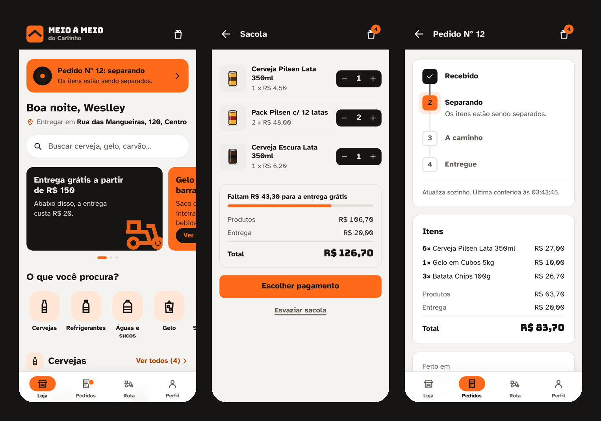
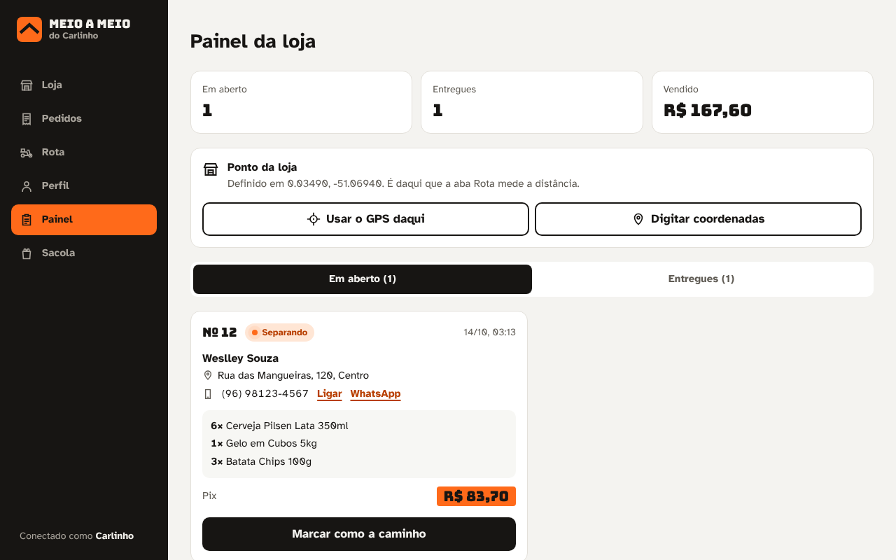
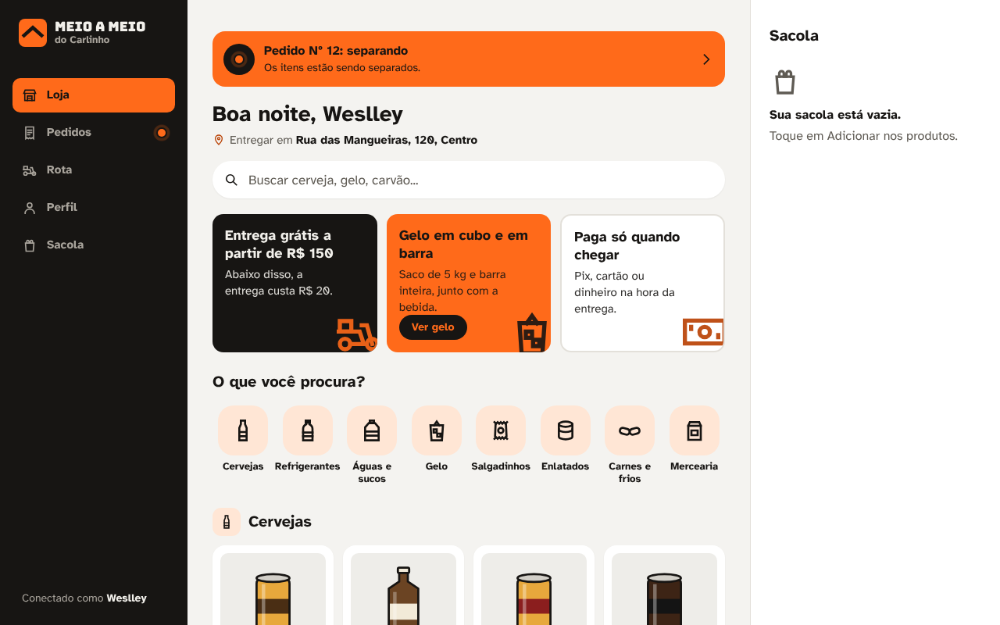

# Meio a Meio do Carlinho

App de pedidos para um depósito de bebidas de bairro. O cliente monta a sacola, paga na entrega e
acompanha o pedido em tempo real; o dono recebe os pedidos num painel e avança cada etapa.



| Parte | Tecnologia | Pasta |
|---|---|---|
| Back-end | Java 21, Spring Boot 3, Spring Security + JWT, JPA, H2 (ou MySQL) | [`backend`](backend) |
| Front-end | React 18, Vite, Tailwind CSS 4, React Router | [`web`](web) |

## O que dá para fazer

**Cliente:** criar conta (com confirmação de 18+), buscar produtos sem se preocupar com acento,
montar a sacola (que sobrevive a recarregar a página), ver quanto falta para a entrega grátis,
escolher Pix, cartão ou dinheiro na entrega, acompanhar o pedido atualizando sozinho e ver a
distância da loja até ele pelo GPS.

**Dono da loja:** painel com pedidos em aberto e entregues, aviso quando chega pedido novo,
botão para avançar a etapa, atalho para ligar ou chamar o cliente no WhatsApp e definição do
ponto da loja por GPS ou coordenadas coladas do Google Maps.



## Como rodar

Pré-requisitos: JDK 21 e Node.js 20 ou mais novo.

```bash
# 1. API (porta 8080) — o Maven Wrapper baixa o Maven sozinho
cd backend
./mvnw spring-boot:run        # no Windows: mvnw.cmd spring-boot:run

# 2. App web (porta 5173), em outro terminal
cd web
npm install
npm run dev
```

Abra `http://localhost:5173`. No Windows também dá para usar os atalhos `backend/rodar-backend.cmd`
e `web/rodar-web.cmd`.

Login do dono para testar o painel: telefone `99999999999`, senha `admin123`
(criado automaticamente na primeira execução, junto com os 30 produtos). Essa senha só vale no
ambiente local: em produção ela vem de `ADMIN_SENHA` e a API avisa no log se subir com a padrão.

Testes (incluindo os de segurança): `cd backend && ./mvnw test`, ou `backend/testar-backend.cmd` no Windows.

## Decisões de projeto

- **A regra de preço mora no servidor.** Entrega grátis a partir de R$ 150, senão R$ 20. O front
  mostra uma prévia, mas quem calcula o valor cobrado é o `PedidoService`.
- **"Tempo real" com consulta periódica, sem WebSocket.** O hook `useRepetir` consulta o servidor de
  tempos em tempos, pausa com a aba escondida e para quando o pedido é entregue. Para o volume de
  uma loja de bairro é suficiente e bem mais simples de manter.
- **JWT com o id do usuário**, não o telefone: trocar o telefone no perfil não derruba a sessão.
- **Segurança testada, não só configurada.** 21 testes automáticos tentam ataques reais (token
  forjado, SQL injection, força bruta, IDOR, virar admin pelo cadastro, preço adulterado) e rodam no
  CI a cada push, junto com CodeQL, `npm audit` e Dependabot. Endereço cifrado com AES-256-GCM,
  senha com BCrypt, logs de segurança prontos para SIEM. Um pentest manual achou uma falha (token de
  admin forjável com a chave de desenvolvimento pública), que foi corrigida e virou teste de
  regressão. O que existe, onde está e o que falta:
  [`SECURITY.md`](SECURITY.md).
- **Segredos por variável de ambiente** (`JWT_SECRET`, `APP_CRIPTO_CHAVE`, `ADMIN_SENHA`, `DB_*`,
  `CORS_ORIGIN`). Sem `JWT_SECRET` a chave é sorteada a cada subida; no perfil `prod` não há padrão
  nenhum e a API não sobe se faltar algum.
- **Acessibilidade:** texto branco no laranja da marca dava 2,9:1 de contraste, então os botões usam
  texto preto (6,4:1); foco visível no teclado; animações desligadas para quem pede menos movimento.
- **Ícones e ilustrações próprios** em SVG, sem fotos de marcas (a loja não tem direito de uso).

Mais detalhes em [`web/README.md`](web/README.md) e [`backend/README.md`](backend/README.md).



## Próximos passos

- Mais testes: regra de frete e serviços no back-end (JUnit) e fluxo de compra no front (Playwright).
- Refresh token com revogação e segundo fator para a conta do dono (ver [`SECURITY.md`](SECURITY.md)).
- Troco para pagamento em dinheiro.
- Notificação no navegador quando o pedido muda de etapa.
